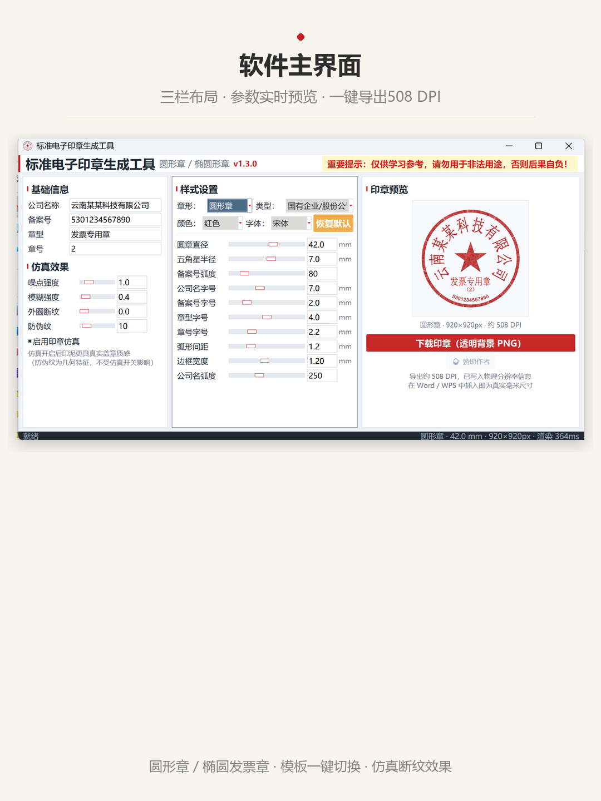
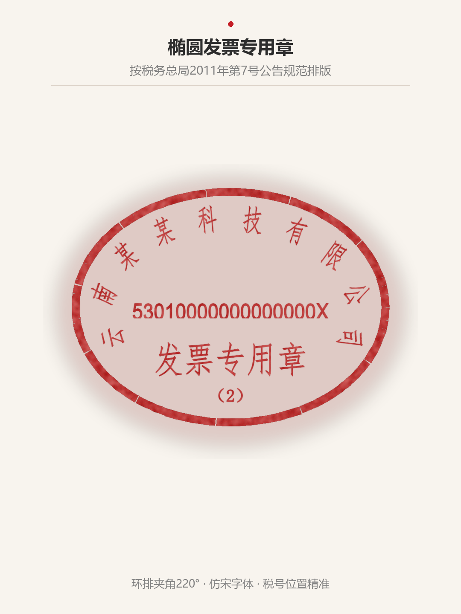
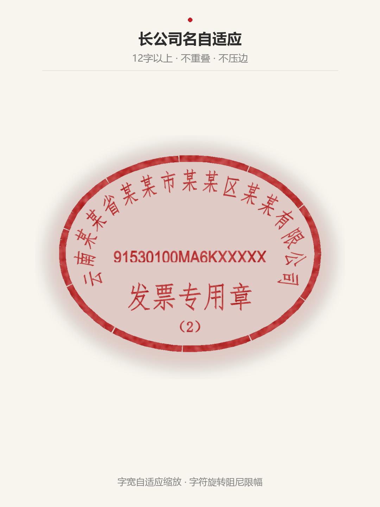
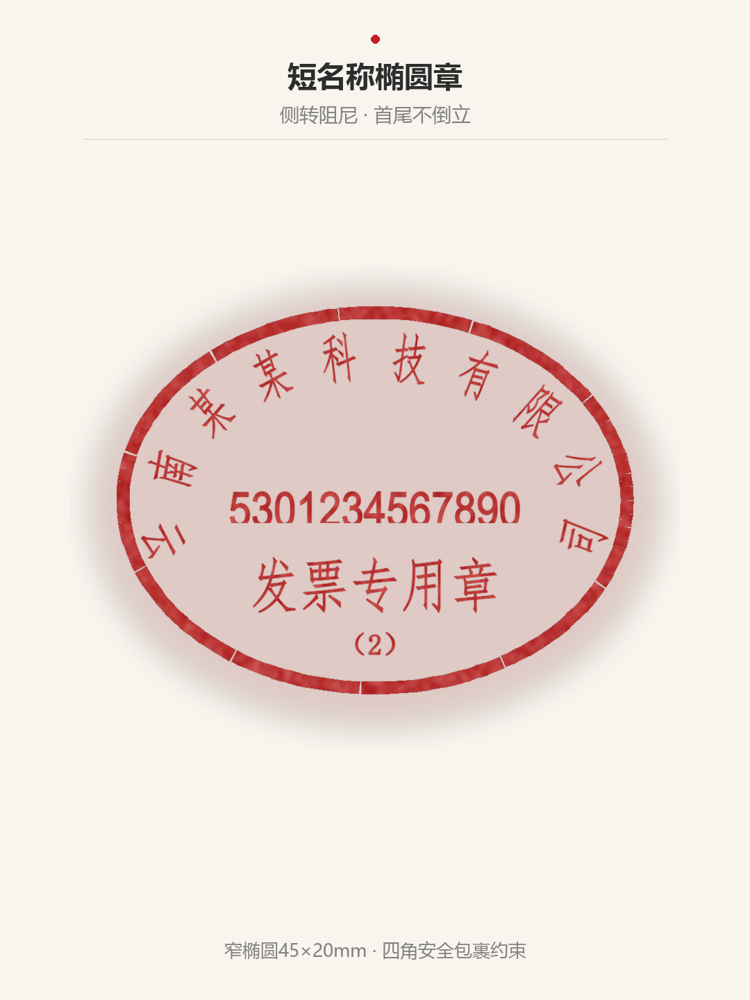

<div align="center">


<h3>🔴 标准电子印章生成工具 · PDF 签章一体化</h3>

<p>
  <b>圆形章 / 椭圆发票章 · 毫米级精度 · 508 DPI 导出 · 一键定点 / 骑缝签章</b>
</p>

<p>
  
  
  
  
  
  
  
</p>



</div>

---

## 📑 目录

- [✨ 功能特性](#-功能特性)
- [📸 效果展示](#-效果展示)
- [🚀 快速开始](#-快速开始)
- [🎯 使用流程](#-使用流程)
- [🛠️ 技术栈](#️-技术栈)
- [❓ 常见问题](#-常见问题)
- [🗺️ Roadmap](#️-roadmap)
- [⚠️ 免责声明](#️-免责声明)
- [☕ 支持我](#-支持我)

---

## ✨ 功能特性

<div align="center">

| 模块 | 能力 |
|------|------|
| 🔴 **双章型** | 圆形公司章、椭圆发票专用章 |
| 📋 **6 套预置模板** | 国企 / 有限公司 / 个体 / 社团 / 行政机关 / 发票章 |
| 📏 **税务规范** | 按国税总局 2011 年第 7 号公告排版（环排 220°、税号位置、仿宋字体） |
| 📐 **毫米级精度** | 导出 PNG 写入 508 DPI，Word/WPS 插入即真实尺寸；签章按同一毫米值换算 |
| 🎨 **仿真盖章** | 噪点 / 模糊 / 外圈断纹三滑块，还原印泥缺角糊边质感 |
| 🧩 **自适应排版** | 长公司名自动缩字、字符旋转阻尼，杜绝重叠与首尾倒立 |
| 📄 **PDF 定点签章** | 1–10 档水平 / 垂直定位、20–100 mm 章径、10–100% 不透明度、页码范围 `1,3-5` |
| 📑 **PDF 骑缝签章** | 整章按页数等分切片、贴左 / 贴右边缝、20–80 mm 章宽，至少 2 页 |
| 🔄 **印章角度** | 固定角度 `-180~180°` 或指定区间每页随机角度；「换一组」重掷；骑缝仅支持固定角度 |
| 🗂 **批量与预览** | 多选 PDF 批量另存、右栏所见即所得实时预览、进度条与可终止任务 |
| 🔗 **流程打通** | 设计页渲染的 RGBA 印章实时送入签章页，无需先保存 PNG |
| 🖱 **正文可选中复制** | 状态栏 / 规格信息 / 说明文字 / 文件列表行 / 输入框支持左键拖选，选中后按 `Ctrl+C` 或右键「复制」；按钮与控件标签不可选中 |
| 🔒 **纯本地** | 不上传任何数据，离线可用 |

</div>

> 适用场景：设计演示、教学课件、手账素材、合同 / 报告排版中的占位印章素材、电子文档批注演示。

---

## 📸 效果展示

<div align="center">

| 圆形合同专用章 | 椭圆发票专用章 |
|:---:|:---:|
|  |  |
| 长公司名自适应缩字 | 短公司名窄椭圆章 |
|  |  |

</div>

---

## 🚀 快速开始

### 方式一：下载安装包（推荐）

前往 [Releases](https://github.com/Mine1178/SealMaker/releases/latest) 下载最新版安装包，双击安装即可使用，无需配置 Python 环境。

### 环境要求
- **OS**：Windows 10 / 11
- **Python**：3.10 及以上（仅源码运行需要）
- **依赖**：`Pillow`、`numpy`、`PyMuPDF`（签章功能需要；缺失时印章生成仍可用）

### 方式二：从源码运行

```bash
# 1. 克隆仓库
git clone https://github.com/Mine1178/SealMaker.git
cd SealMaker

# 2. 安装依赖
pip install -r requirements.txt

# 3. 启动
python SealMaker_v1.6.0.py
```

---

## 🎯 使用流程

```
┌─────────────┐   ┌─────────────┐   ┌─────────────┐   ┌─────────────┐
│  ① 设计印章  │ → │ ② 送入签章   │ → │ ③ 设置签章   │ → │ ④ 另存成品   │
│ 选章型/调参数 │   │ 内存印章实时同步│  │ 模式/范围/样式 │   │ 批量签章 PDF │
└─────────────┘   └─────────────┘   └─────────────┘   └─────────────┘
```

**工作区 A · 印章设计**
1. **选章型**：圆形章 或 椭圆发票章
2. **填信息**：公司名称、备案号、章号
3. **调参数**：直径、五角星半径、字号、环排角度、边框宽度
4. **下载 / 送入**：右侧实时预览，可「下载印章（透明背景 PNG）」，
   或点「使用当前印章 → 去签章」直接切到工作区 B

**工作区 B · PDF 签章**（左栏设置 / 右栏所见即所得预览）

1. **左栏 · 印章来源**：默认「当前生成的印章」（实时同步，自动带入毫米尺寸），也可改选本地透明 PNG
2. **左栏 · 选 PDF**：多选批量；列表显示页数与 PDF 版本
3. **左栏 · 设参数**：定点 / 骑缝、页码范围、位置档位、章径、不透明度；
   按当前模式只显示一组参数，设置项变化即自动刷新右栏，无需点「预览」
4. **右栏 · 实时预览**：整页显示首张目标页 + 印章落点，横 / 纵方向随 PDF 自动匹配；
   未选择 PDF 时以空白 A4 示意。页面底图按文件缓存，拖动滑块只重做印章合成
5. **开始签章**：批量另存 `<原名>_定点已签章.pdf` / `_骑缝已签章.pdf`

### 印章角度

| 项目 | 说明 |
|------|------|
| **适用场景** | 模拟手工盖章时印章不会绝对端正的观感，用于合同、报表等多页文档的视觉真实感增强；不改变印章物理毫米尺寸，也不属于数字签名 |
| **模式一 · 固定角度** | 选「固定」，拖动角度滑块设 `-180°~180°`（逆时针为正）；所有目标页使用同一角度 |
| **模式二 · 区间随机** | 选「区间随机」，填写区间下限 / 上限（如 `-10° ~ 10°`）；**每页独立**生成一个角度，可用「换一组」重掷一组 |
| **可复现性** | 随机值由 `(种子, 文件名, 页码)` 哈希生成，因此右栏预览与实际签章的第一页角度完全一致，同一配置重复签章结果不变 |
| **骑缝章限制** | 骑缝章是把**整枚章旋转后一次性等分切片**，每页一片，跨页要能拼回完整印章；若每片角度不同则无法拼接，故骑缝模式强制固定角度、区间随机选项被禁用，界面与配置层双重兜底 |
| **实现** | PyMuPDF 的 `insert_image(rotate=)` 仅支持 90° 倍数，故任意角度在 Pillow 图像层用 `rotate(..., expand=True)` 预旋转，再以原落点为中心按外接框插入；预览与成品共用同一函数 |

---

## 🛠️ 技术栈

<p>
  
  
  
  
  
  
  
  
</p>

**核心算法**：自定义弧排引擎、旋转矩形 SAT 碰撞检测、印泥噪点合成、字符旋转阻尼限幅；
PDF 签章基于 PyMuPDF 的 `page.insert_image`（RGBA alpha 改写法实现透明度、精确 mm→pt、
`derotation_matrix` 校正旋转页、整章等分切片实现骑缝）。

---

## ❓ 常见问题

**Q：导出的 PNG 插入 Word 后尺寸对吗？**
A：导出文件按 508 DPI 写入毫米级尺寸信息，在 Word / WPS 中按原始尺寸插入即为真实章面大小，缩放时注意保持纵横比。

**Q：软件需要联网吗？**
A：不需要。印章生成全程在本地完成，不上传公司名称、备案号等任何输入内容，可离线使用。

**Q：公司名字很长会不会排成一圈挤不下？**
A：长公司名会自动缩小字号并调整环排角度，配合字符旋转阻尼避免重叠与首尾倒立；短名称则按窄椭圆 / 小直径自适应排版。

**Q：生成的章可以直接盖在正式合同上吗？**
A：不可以。本工具产出的是电子素材图，仅供演示、教学、设计与手账等合法用途；真实公章、财务章、发票章必须到公安机关备案点刻制，详见下方免责声明。

**Q：支持方形章、五角星章或其他形状吗？**
A：当前版本仅提供圆形章与椭圆发票章；方形章、菱形章等已列入 Roadmap，尚未发布。

---

## 🗺️ Roadmap

- [x] v1.3.0 — 椭圆章弧排引擎重写，修复字符重叠/压边/首尾倒立
- [x] v1.4.0 — 椭圆章防倒立 / 备案号截断修复，赞助按钮
- [x] v1.5.0 — **PDF 签章一体化**（定点 / 骑缝 / 批量 / 预览）+ 双工作区界面重排
- [x] v1.6.0 — 界面细节打磨、全量功能复核、共享构件抽取、双版本打包交付
- [ ] v1.7.0 — 批量生成（Excel 名单一键出章）、自定义章面底色 / 多色章
- [ ] v1.8.0 — 方形章 / 菱形章支持

---

## 📦 发行版本（v1.6.0）

两个版本**功能完全一致**（同一份源码、同一个自包含 exe），仅分发与系统集成方式不同：

| 版本 | 文件 | 构建配置 | 系统集成 |
|---|---|---|---|
| **免安装便携版** | `印章大师_v1.6.0_免安装版.zip` | `SealMaker_v1.6.0.spec`（PyInstaller onefile） | 解压即用，不写系统目录 / 注册表 |
| **标准安装版** | `印章大师_v1.6.0_安装版.exe` | `打包/SealMaker_tool.iss`（Inno Setup 6） | 开始菜单 + 桌面快捷方式 + 卸载项 |

体积已精简：移除 `pymupdf.mupdf-devel`（C++ 开发库，~6.8MB）与 `PIL._avif`（AVIF 解码器，~7.9MB）等冗余，并排除所有无关重型包（matplotlib/scipy/pandas/Qt/Jupyter/setuptools…）。
载荷 exe **60.5MB → 52.6MB**。PyMuPDF（签章核心）与 NumPy（仿真印章算法必需）为不可移除的刚需，详见 `打包指令集.txt`。

---

## ⚠️ 免责声明

> 本软件**仅供学习、设计演示、教学课件、手账素材等合法用途**。
>
> - 真实公章 / 财务章 / 发票章须到 **公安机关备案点**刻制
> - 严禁用于伪造、变造公司印章或任何违法活动
> - PDF 签章只是**可见印章图像叠加**，不含数字证书 / 签名值 / 验签信息，
>   **不属于**《电子签名法》意义上的电子签名（PAdES），不具备防篡改或法律效力
> - 使用本软件产生的一切后果由使用者自行承担

---

## ☕ 支持我

如果这个工具帮到了你，欢迎请我喝杯咖啡 ☕

<div align="center">
  
  
</div>

---

<div align="center">

📄 **License**：[MIT](LICENSE) ｜ ⭐ 如果喜欢，请给个 Star 鼓励一下！

</div>
