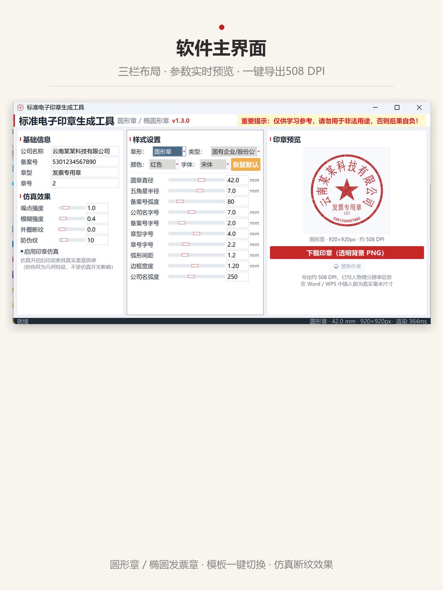
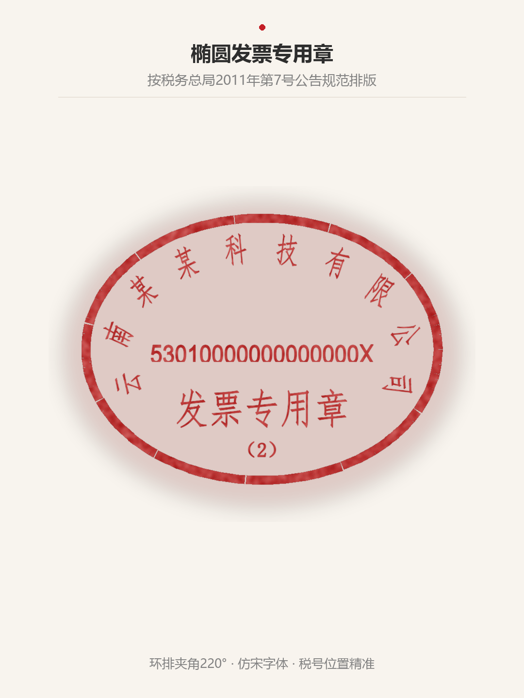

# SealMaker · 标准电子印章生成工具

[](https://www.python.org/)
[](#)
[](#)
[](#)

> 圆形章 / 椭圆发票章一键生成，毫米级精度，导出 PNG 直接插入 Word/WPS。



## ✨ 功能特性

- **双章型支持**：圆形公司章、椭圆发票专用章
- **6 套官方预置模板**：国有企业、有限公司、个体私营、社团、行政机关、发票专用章
- **税务规范排版**：发票专用章按《国家税务总局 2011 年第 7 号公告》式样排版（环排夹角 220°、税号位置、仿宋字体）
- **毫米级精度**：导出 PNG 写入 508 DPI 物理分辨率，插入 Word/WPS 即为真实毫米尺寸
- **仿真盖章效果**：噪点、模糊、外圈断纹三个滑块，模拟真实印泥缺角、糊边质感
- **自适应排版**：长公司名自动缩字、字符旋转阻尼限幅，杜绝重叠和首尾倒立
- **纯本地运行**：不上传任何数据，离线可用

## 📸 效果展示

| 圆形合同章 | 椭圆发票章 |
|------------|------------|
|  |  |

## 🚀 快速开始

### 环境要求
- Windows 10/11
- Python 3.10+
- 依赖：`Pillow`、`numpy`

### 运行
```bash
pip install pillow numpy
python SealMaker_v1.3.0.py
```

### 使用流程
1. 选择章型（圆形章 / 椭圆章）
2. 在「基础信息」填写公司名称和备案号
3. 在「样式设置」调整直径、字号、环排角度等参数
4. 右侧实时预览，满意后点「下载印章（透明背景 PNG）」

## 📁 项目结构

```
SealMaker/
├── SealMaker_v1.3.0.py    # 主程序（单文件）
├── app.ico                 # 应用图标
├── images/                 # README 配图
└── README.md
```

## ⚠️ 免责声明

本软件**仅供学习、设计演示、教学课件、手账素材等合法用途**。

- 真实公章/财务章/发票章须到**公安机关备案点**刻制
- 严禁用于伪造、变造公司印章或任何违法活动
- 使用本软件产生的一切后果由使用者自行承担

## 📄 License

MIT License
